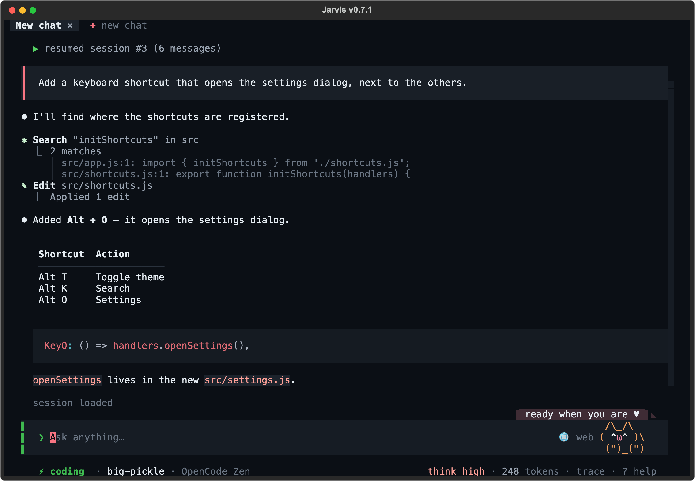
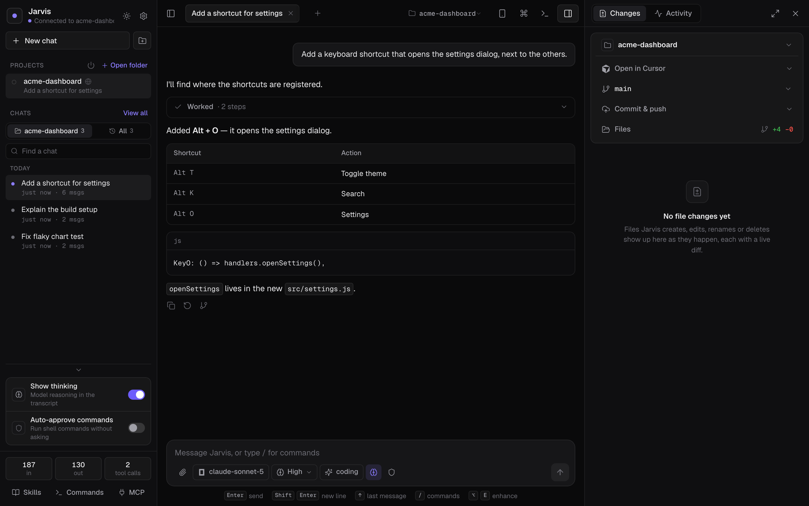

<div align="center">


# Jarvis

### Your AI helper that reads, writes and fixes code — for free.

Ask in plain words. Jarvis reads your project, makes the changes and checks its own work.<br/>
No account, no API key, no credit card — it works the moment you install it.

[](https://www.python.org/downloads/)
[](#install)
[](#first-run)
[](https://github.com/PrajsRamteke/harness-agent/stargazers)

**[Install](#install)** &nbsp;·&nbsp; **[In the terminal](#terminal)** &nbsp;·&nbsp; **[In the browser](#browser)**

</div>

<br/>

## ✨ What it does

| | |
| :-- | :-- |
| 💬 **Just ask** | "Fix the failing test", "explain this project", "add a dark mode". Jarvis does the work. |
| 🆓 **Free from day one** | Starts on a free model. Bring Claude, ChatGPT or your own key later if you want. |
| 🧠 **Remembers you** | Keeps your preferences and learns from every task it solves. |
| 📱 **Follows you anywhere** | Open the same chat in a browser or on your phone. |
| ✅ **Asks before risky steps** | You approve commands and see every file it changes. |

<br/>

<a id="install"></a>

## 📦 Install

You need **Python 3.10 or newer**. Copy one line, paste it in your terminal, press Enter.

**🍎 macOS · 🐧 Linux**

```bash
curl -fsSL https://raw.githubusercontent.com/PrajsRamteke/harness-agent/main/scripts/install | bash
```

**🪟 Windows** (PowerShell)

```powershell
powershell -ExecutionPolicy ByPass -c "irm https://raw.githubusercontent.com/PrajsRamteke/harness-agent/main/scripts/install.ps1 | iex"
```

Then **open a new terminal** so the commands are ready.

<details>
<summary>Don't have Python yet?</summary>

<br/>

**macOS**

```bash
brew install python@3.11
```

**Windows**

```powershell
winget install -e --id Python.Python.3.12
winget install -e --id Git.Git
```

Then run the install line above again.

</details>

<br/>

<a id="terminal"></a>

## 🖥️ In the terminal — `jarvis`

Go to your project folder and start chatting:

```bash
cd my-project
jarvis
```

<p align="center">
  
</p>

> **Tip:** type `/` to see every command, and `?` for keyboard shortcuts.

<br/>

<a id="browser"></a>

## 🌐 In the browser — `jw`

Prefer a normal app window? Run `jw` in your project folder. Jarvis opens in your browser, and you can close the terminal — it keeps running.

```bash
cd my-project
jw
```

<p align="center">
  
</p>

> **Tip:** `jw stop` stops it. On Windows, use `jarvis web`.

<br/>

<a id="first-run"></a>

## 🚀 First run

Nothing to set up — Jarvis starts on a free model right away. When you want more:

| Type this | To |
| :-- | :-- |
| `/model` | Pick a different model (free ones are listed first) |
| `/provider` | Sign in with **Claude** or **ChatGPT**, or add an API key |
| `/web` | Get a QR code to open this chat on your phone |

<br/>

## 🔄 Update or remove

<details>
<summary>Update</summary>

<br/>

Jarvis checks for updates by itself each time it starts. To update now:

```bash
jarvis update
```

</details>

<details>
<summary>Uninstall</summary>

<br/>

**macOS · Linux**

```bash
rm -f "$(command -v jarvis)" "$(command -v jw)"
rm -rf ~/.local/share/harness-agent
rm -rf ~/.config/harness-agent      # optional: your settings and chats
```

**Windows**

```powershell
Remove-Item -Recurse -Force "$env:LOCALAPPDATA\harness-agent", "$HOME\.local\bin\jarvis.cmd"
```

</details>

<br/>

## 💬 Help

- 🐞 [Report a bug or ask for a feature](https://github.com/PrajsRamteke/harness-agent/issues)
- 💡 [Ask a question or share an idea](https://github.com/PrajsRamteke/harness-agent/discussions)

<br/>

<div align="center">

Built by [Prajwal Ramteke](https://github.com/PrajsRamteke) **If Jarvis helps you, give it a ⭐**

</div>
